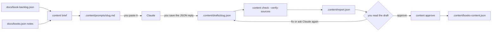

# Book Content Tool

## Goal

A developer keeps a **backlog** of the books that still need content, and gets real editorial copy for each one: a tagline, a meta description, "what it's about", "why people are reading it", "why it matters" and an author bio, written in the voice of a literary critic and a storyteller, and checked against its sources. The tool turns each backlog entry into a **prompt to paste into Claude** (the developer uses a separate Claude subscription, so the tool never calls an AI service). The developer saves Claude's reply as a draft file. The tool then validates the draft (limits, plain text, sources, figures), checks that every cited figure appears on the cited page, lets the developer approve it, and collects the approved copy in **one output file**. It is **developer tooling**. The app does not use it, and for now the output file is not read by the seed or the app (see Out of scope).

The writing itself is done by Claude, outside the tool. The tool only prepares the prompt and checks the answer.

### What this automates from the chat

| Manual step in the chat | Automated by |
|---|---|
| Writing the critic/storyteller research prompt, with the field list and limits | `content brief`: one ready-to-paste prompt per book, generated from the same limits the validator enforces |
| Keeping track of which books still need content | The backlog file and `content status` |
| Starting from `docs/books.json` (`about`, `why_popular`, `author_bio`, `sources`) | `content brief`: matching entries are attached to the prompt as unverified notes |
| Re-reading the output for word counts, sources, no markdown, no spoilers, valid JSON | `content check`: schema, limits, text rules, source rules, figure rules |
| "Factually correct" | `facts[]` in the draft plus `content check --verify-sources` |
| Turning the output into one file like `books.json` | `content approve`, which writes `.content/books-content.json` |

## Scope

**In scope**

- A **backlog file** (`docs/book-backlog.json`) listing the books that want content, started with the 25 seeded classics and 4 bestsellers from `docs/books.json`.
- A CLI with four commands: `status`, `brief`, `check` and `approve`.
- A per-book **prompt** (`brief`, Markdown) that the developer pastes into Claude, and that asks for a reply that is only a JSON draft.
- A **draft** format (one JSON file per book, saved by the developer from Claude's reply), validated with Zod. It carries **1–5 `genres`** for the book, which are stored for later use and not used by anything yet.
- Mechanical checks on drafts: limits, plain-text rules, source rules, figure coverage, quote length, placeholder and hype-term detection.
- An optional online check that each cited figure's evidence text appears on its cited page.
- A human **approval** step that adds a checked draft to one output file, `.content/books-content.json`.
- Tests that run without a network, without a database and without an AI service.

**Out of scope**

- Calling Claude or any other AI API from the tool. The developer pastes prompts by hand.
- **Using the output in the app, for now.** The seed, the Prisma schema, every route and every component stay as they are. The output file is not committed (`.content/` is gitignored), and wiring it into the seed is a later spec. Its field names match the `Book` model so that later step is small, except `genres`, which has no column yet (see Risks).
- Adding the backlog's books to the seed or to a scene. The backlog is a to-do list for content, not the catalog. Placements stay in the seed and the scenes (see [multiple-bookshop-scenes.md](multiple-bookshop-scenes.md)).
- **Doing anything with the genres.** They are stored in the draft and in the output file only. No filter, shelf, route, component, seed step or `Book` column uses them yet. A later spec will.
- `affiliateUrl`, `coverImage`, `palette` and `popularityRank`. Covers are [book-cover-fetcher.md](book-cover-fetcher.md).
- Other languages. All copy is English.
- Detecting spoilers, tone or plagiarism mechanically. These are review-checklist items, not automated checks.
- Crawling. The tool fetches only the URLs a draft cites, once each.
- Scheduling, CI runs against the real internet, and backlogs over 100 books.
- Telling readers on the site that the text was AI-assisted (decided: no).

## Data Model

**No database change and no Prisma migration.** The tool reads and writes files only. The `Book` model already has `tagline`, `summary`, `about`, `whyPopular`, `whyItMatters` and `authorBio`, and the output uses the same names.

### Backlog file

`docs/book-backlog.json` is the list of books that still want content. It is committed, edited by hand, and is the input of `status` and `brief`.

```ts
// Illustrative — scripts/content/backlog.ts, Zod, strict
type Backlog = {
  version: 1;
  books: {
    title: string;      // 1–200 characters
    author: string;     // 1–200 characters, several authors allowed ("Neil Gaiman & Terry Pratchett")
    isbn?: string;      // optional, validated like the cover tool; kept so one backlog can feed both tools
    origin: "classics" | "bestsellers" | "other";
    notes?: string;     // free text for the developer, at most 500 characters; not put in the prompt
  }[];
};
```

- The slug of an entry is `slugify(title)` (the shared function in `src/lib/slug.ts`, described in [book-cover-fetcher.md](book-cover-fetcher.md)). Two entries with the same slug, an empty slug, or more than 100 entries are errors that name the entries.
- **Status is derived, never stored**, so it can't drift: a book is `new` (nothing yet), `briefed` (a prompt file exists), `drafted` (a draft file exists) or `approved` (it is in the output file). The most advanced state wins.
- An approved book stays in the backlog.
- The cover tool's `<list-file>` is a separate text file. `content status --list` prints the backlog as `Title | Author | ISBN` lines (one per entry, ISBN column only when present), so it can be saved and given to `covers:fetch`.

**Initial contents** (25 classics in the seed's order, then 4 bestsellers from `docs/books.json`, ranks 1–4):

| `origin` | Entries (title — author) |
|---|---|
| `classics` | The Hobbit — J.R.R. Tolkien · 1984 — George Orwell · Fahrenheit 451 — Ray Bradbury · Brave New World — Aldous Huxley · Animal Farm — George Orwell · The Great Gatsby — F. Scott Fitzgerald · To Kill a Mockingbird — Harper Lee · The Catcher in the Rye — J.D. Salinger · The Odyssey — Homer · Stardust — Neil Gaiman · The Night Circus — Erin Morgenstern · Frankenstein — Mary Shelley · Dracula — Bram Stoker · Jane Eyre — Charlotte Brontë · Wuthering Heights — Emily Brontë · Dune — Frank Herbert · Foundation — Isaac Asimov · Hyperion — Dan Simmons · Neuromancer — William Gibson · The Name of the Wind — Patrick Rothfuss · A Game of Thrones — George R.R. Martin · A Wizard of Earthsea — Ursula K. Le Guin · Good Omens — Neil Gaiman & Terry Pratchett · The Shadow of the Wind — Carlos Ruiz Zafón · The Starless Sea — Erin Morgenstern |
| `bestsellers` | Theo of Golden — Allen Levi · The Let Them Theory — Mel Robbins · Dear Debbie — Freida McFadden · Project Hail Mary — Andy Weir |

The titles and authors of the classics must equal those in `prisma/seed.ts`, so a later import into the seed matches by slug. The tool does not read the seed.

### Folders and files

```text
docs/book-backlog.json            committed, the backlog
.content/                         gitignored, all working files and the output
  prompts/<slug>.md               generated by `content brief`, pasted into Claude
  drafts/<slug>.json              saved by the developer from Claude's reply
  report.json                     written by `content check`
  books-content.json              the output file, written by `content approve`
```

- A slug always matches `^[a-z0-9]+(?:-[a-z0-9]+)*$` and is at most 100 characters. A draft's file name is `<slug>.json`, and the `slug` inside must equal it.
- `.content/` is gitignored, so nothing is committed for now. The developer should back up `.content/books-content.json` or commit it deliberately when ready.

### Output file

`.content/books-content.json`, in the spirit of `docs/books.json`:

```ts
// Illustrative
type ContentFile = {
  version: 1;
  generated: string;                      // ISO 8601, set by `approve`
  books: ApprovedBook[];                  // sorted by slug
};
```

It is rewritten completely and atomically (temporary file, then rename) each time `approve` adds or replaces a book, validated with Zod when read and written.

### Limits (one module, used by the prompt and the validator)

`scripts/content/limits.ts` is the only place these numbers live. The prompt text is rendered from it, so the prompt and the checker cannot drift apart. The limits are expected to change, and changing them means editing that one file.

The maxima are three times the first draft's values (decided 2026-10-26). The minimums are unchanged.

| Field | Rule |
|---|---|
| `tagline` | 1–240 characters, no trailing `.` |
| `summary` | 140–480 characters |
| `about` | 80–360 words |
| `whyPopular` | 80–360 words |
| `whyItMatters` | 80–360 words |
| `authorBio` | 50–240 words |
| `genres` | 1–5 entries, each 1–40 characters, distinct when compared case-insensitively |
| `sources` | 2–8 distinct `https:` URLs, on at least 2 distinct hostnames |
| `facts` | 0–30 entries |
| `needsReview` | 0–10 strings of at most 300 characters |

A **word** is a run of non-whitespace characters, so `well-known` is one word. A **character** is a Unicode code point.

### Draft file

```ts
// Illustrative — scripts/content/schema.ts, Zod. The field names match the Book model.
type BookContentDraft = {
  version: 1;
  slug: string;
  title: string;
  author: string;
  tagline: string;
  summary: string;
  about: string;
  whyPopular: string;
  whyItMatters: string;
  authorBio: string;
  genres: string[];                                    // 1–5 genres of the book, free text, stored for later use
  sources: string[];                                   // https URLs actually used
  facts: { claim: string; sourceUrl: string; evidence: string }[];
  confidence: "high" | "medium" | "low";
  needsReview: string[];                               // claims the writer could not fully verify
  drafter: string;                                     // free text, e.g. "Claude" and the model name Claude reports
};

type ApprovedBook = BookContentDraft & {
  review: {
    approvedAt: string;                                // ISO 8601
    verification: "complete" | "partial" | "skipped";
    warningsAccepted: boolean;
    draftSha256: string;                               // hash of the draft file that was checked
  };
};
```

- The schema is `.strict()`: an unknown key is an error.
- `genres` are short genre names in English (for example `Gothic fiction`, `Science fiction`), at least 1 and at most 5, most specific or most useful first. They are a plain list of labels: the tool does not map them to a fixed vocabulary, and nothing reads them yet.
- `title` and `author` in a draft must equal the backlog entry's (exact match after trimming), which catches a reply about the wrong book.
- `facts[].claim` is the figure or dated statement exactly as it appears in the prose (for example `1.8 million`), `sourceUrl` must be one of `sources`, and `evidence` is a 10–300 character quote copied from that page that supports the claim.
- `confidence` and `needsReview` are the writer's honest self-report. They are kept in the approved entry for later audits.
- There is no timestamp in a draft: Claude does not reliably know the date, and `approve` records the date itself.

### Text rules (hard errors, applied to `tagline`, `summary`, `about`, `whyPopular`, `whyItMatters`, `authorBio`)

1. One line: no newline or other control characters, no leading or trailing whitespace.
2. Plain text: no HTML tags (`<` followed by a letter or `/`), no Markdown (backticks, `**`, a leading `#`, `[text](url)`).
3. No placeholder words: `placeholder`, `lorem`, `TODO`, `TBD` (case-insensitive, whole word).
4. **Quotes:** any span in double quotes (straight or curly) is at most 15 words.
5. **Figures:** a *figure* is any digit run, `\d+(?:[.,]\d+)*`. Every figure in the prose, except figures that occur in the `title` (`1984`, `Fahrenheit 451`), must appear inside at least one `facts[].claim`. Every `facts[].claim` must occur in the prose as an exact substring. A figure without a fact, or a fact that is not in the prose, is an error. This is what forces every number and date to carry a source.

Rules 1–3 also apply to every entry of `genres`. Rules 4 and 5 do not: genres are labels, not prose, so a genre such as `20th-century fiction` needs no fact. A genre list with fewer than 1 or more than 5 entries, an entry outside 1–40 characters, or two entries that are equal when compared case-insensitively is an error.

### Warnings (do not fail `check`, but block `approve` without `--accept-warnings`)

- `confidence` is not `"high"`.
- `needsReview` is not empty.
- A hype term appears (`masterpiece`, `unputdownable`, `must-read`, `page-turner`, `tour de force`, `game-changer`, `groundbreaking`, `riveting`; one list in `scripts/content/limits.ts`).
- Online verification (below) did not give `verified` for every fact.

### Report

`.content/report.json` is rewritten by every `content check`, validated with Zod.

```ts
// Illustrative
type CheckReport = {
  generatedAt: string;
  drafts: {
    slug: string;
    draftSha256: string;
    errors: { field: string; rule: string; message: string }[];
    warnings: { field: string; rule: string; message: string }[];
    verification: null | {                              // null when --verify-sources was not used
      facts: { claim: string; sourceUrl: string; result: "verified" | "not-found" | "unreachable" | "blocked-url" }[];
    };
  }[];
};
```

## API Contracts

There are no Server Actions or route handlers. The contract is the command line and the files above.

### Workflow



### Invocation

```text
npm run content -- status  [--list]
npm run content -- brief   [<slug>...] [--all] [--stdout]
npm run content -- check   [<slug>...] [--verify-sources] [--approved]
npm run content -- approve <slug>... [--accept-warnings] [--skip-verification] [--replace]
```

`package.json` gets one script: `"content": "tsx scripts/content/cli.ts"`. Every command reads `docs/book-backlog.json`, and `--backlog <path>` overrides that. Flags are parsed with `util.parseArgs` in strict mode. An unknown flag, an unknown command or a slug that fails the slug regex is a usage error. Slugs are validated **before** any path is built, so `../x` can never reach the file system.

### `status`

Prints one line per backlog entry: slug, title, author and derived status (`new`, `briefed`, `drafted`, `approved`), then a count per status. With `--list` it prints the cover tool's `Title | Author | ISBN` lines instead (see Backlog file). It makes no network request and writes nothing.

### `brief`

Writes a prompt for Claude, one file per book, to `.content/prompts/<slug>.md`.

- **Which books:** with no slugs, every backlog book that is not `approved`. With slugs, those books (even if approved). With `--all`, every backlog book. A slug that is not in the backlog is a usage error.
- **`--stdout`:** with exactly one book, prints the prompt instead of writing a file, so it can be piped to the clipboard (`| clip`).
- **Starting notes:** it also reads `docs/books.json` if present. A backlog book whose normalised title and author match an entry there gets that entry's `about`, `why_popular`, `author_bio`, `genre`, `publisher`, `first_published` and `sources` as a section **"Starting notes (unverified)"**. It is labelled as a starting point to verify, never as fact. A missing or unreadable `docs/books.json` is not an error, and no book gets notes.
- **A prompt contains:**
  1. The role and voice: critic and storyteller in one, English, present tense for the book and past tense for history, neutral on religion and politics, no hype, one honest reservation.
  2. The sourcing rules: reputable sources, every figure traceable, no guessing, quotes of at most 15 words, no spoilers beyond the opening setup.
  3. **Honesty about browsing:** if Claude cannot open web pages, it must say so in `needsReview`, set `confidence` to `"low"`, and must not invent URLs or evidence quotes.
  4. The field table, rendered from `limits.ts`, and the text rules.
  5. The `facts` rule, with a short example.
  6. The exact reply format: **one JSON object in a single code block, and nothing else**, following a skeleton with `slug`, `title` and `author` already filled in.
  7. The starting notes, when there are any.
- The prompt does not mention files. The developer saves Claude's reply as `.content/drafts/<slug>.json`.
- It is deterministic: the same inputs give byte-identical files. A prompt contains no timestamp, no secret and no contact address, and it is a self-contained message that works in a fresh Claude conversation.

**Required wording.** The prompt text is free, but it must contain each of the following literal strings, so the tests can check wording without guessing. Matching is case-insensitive unless the cell says *exact*. Several strings may sit in one sentence.

| Part | The prompt must contain |
|---|---|
| Voice | `critic`, `storyteller`, `English` (*exact*), `present tense`, `past tense`, `reservation`, `hype` |
| Sourcing | `reputable`, `spoiler`, `15 words` (*exact*), `source`, `invent` |
| Browsing honesty | `browse`, `needsReview` (*exact*), `"low"` with the quotes (*exact*), and one sentence in which `invent`, `make up` or `fabricate` is followed, within 80 characters and with no full stop in between, by `URL`, `quote` or `evidence` (for example "Never invent a URL or an evidence quote.") |
| Facts rule | `facts`, `claim`, `evidence`, `sourceUrl` (*exact*) |
| Reply format | `JSON` (*exact*), `code block`, `nothing else` |
| Field table | for each of the six text fields, one line that contains the field name as a whole word, its minimum and its maximum from `limits.ts` (for example `\| about \| 80–360 words \|`); and one more line that names `genres` with the minimum and the maximum number of genres from `limits.ts` |
| Genres | `genres` (*exact*), `genre`, and an instruction to give short genre names in English |
| Hype terms | every entry of `HYPE_TERMS` |
| Skeleton | a fenced block whose content parses as JSON and has all sixteen draft keys (`genres` included), with `slug`, `title` and `author` filled in and `version` 1 |

The prompt must **not** contain `.content`, `drafts/`, `prompts/` or `.json` (so no file name, path or extension appears anywhere, including the language tag of the fence, which is `json` without a dot).

### `check`

- With no slugs it checks every file in `.content/drafts/`. With slugs, only those.
- `--approved` checks `.content/books-content.json` instead, with the offline rules only (schema including `review`, text rules, figure rules and limits).
- **Offline rules** always run: the file is valid JSON (a reply still wrapped in Markdown fences gets a message that says so), schema, slug equals file name, title and author match the backlog entry, limits, text rules, source rules, figure rules, warnings.
- **`--verify-sources`** adds the online check below. It needs `CONTENT_CONTACT`.
- Writes `.content/report.json` (not for `--approved`). Prints one line per draft (`the-hobbit  ok`, `dune  2 errors, 1 warning`) and a summary.

### Online verification (`--verify-sources`)

For every distinct source URL in a draft:

1. Fetch the page once per run (cached by URL). Extract its visible text by removing `script` and `style` content and tags, and decoding entities. No new dependency.
2. For each fact whose `sourceUrl` is that page, check that `evidence` occurs in the page text, after both are normalised (lower case, diacritics removed, curly quotes straightened, whitespace collapsed). The result is `verified` or `not-found`.
3. A page that cannot be read gives `unreachable` for its facts: network error, timeout, HTTP error, a content type other than `text/html`, `application/xhtml+xml` or `text/plain`, or a body over the limit. `blocked-url` means the URL was refused by the rules below.

The check proves that the quoted evidence is on the cited page. It does **not** prove that the evidence supports the claim. That stays a human judgement.

**Request policy** (the same shape as the cover tool):

| Case | Behaviour |
|---|---|
| Identification | `GET` only, with `User-Agent: TreeOfBooksContentTool/1.0 (<contact>)`, no cookies, no credentials. |
| Spacing | At least 1000 ms between requests to the same host, and one request in flight at a time. |
| Timeout and size | 20 s per request. A body over 2 MB is aborted and counts as `unreachable`. |
| Retries | Network errors, timeouts and HTTP 429, 500, 502, 503 and 504: up to 2 retries, waiting `Retry-After` if present and at most 60 s, otherwise 2 s and 4 s. Other 4xx are not retried. |
| Limits | At most 8 sources per draft (the schema), and at most 200 distinct URLs per run. The 201st is not fetched and its facts are `unreachable`. |
| Untrusted URLs | URLs come from an LLM, so they are untrusted. They must be `https:`, on port 443, without user info, and with a host name (not an IP literal). Every address the host resolves to must be public: not loopback, private, link-local, unique-local, CGNAT or cloud-metadata. At most 3 redirects, and every hop is checked again. A refused URL gives `blocked-url`. |
| Page text is data | Fetched text is only compared with `evidence` strings. It is never executed, never written to disk and never given to an LLM. |

Network, DNS, clock and `sleep` are injected so tests never touch the network or wait.

### `approve`

The human review is the act of running this command, so run it only after reading the draft. It adds the draft to `.content/books-content.json` (creating the file if needed), with a `review` block.

It refuses a slug (exit 1, nothing written for that slug) when:

1. The draft has any error.
2. The draft has any warning and `--accept-warnings` was not given.
3. No entry in `.content/report.json` has this draft's current `draftSha256` with `verification` set, and `--skip-verification` was not given. This forces `check --verify-sources` to have been run on exactly this content, and any later edit to the draft requires checking again.
4. The output file already has an entry for this slug and `--replace` was not given.

`review.verification` is `complete` when every fact is `verified`, `partial` when the check ran with other results, and `skipped` with `--skip-verification`. `warningsAccepted` records the flag. `generated` and `review.approvedAt` are set from the clock. Entries are kept sorted by slug. The file is written atomically, once at the end of the command, and several slugs are handled independently.

### Environment

| Variable | Needed | Use |
|---|---|---|
| `CONTENT_CONTACT` | only for `check --verify-sources` | An email address or `https:` URL (3–200 characters, no control characters) for the `User-Agent`. Missing or invalid is exit code 2, before any request. |

Read from the process environment, with `.env` loaded by `process.loadEnvFile()` when it exists (existing variables win). `.env.example` gets the name with an empty value. The contact is never printed or written to a file. No variable is read in `src/`.

### Exit codes

| Code | Meaning |
|---|---|
| 0 | The command did what it was asked, for every book. |
| 1 | `check`: at least one draft has an error. `approve`: at least one slug was refused. Other slugs were still handled. |
| 2 | Usage error, invalid backlog, invalid slug, a slug that is not in the backlog, missing or invalid `CONTENT_CONTACT` when needed, unreadable folder. Always before any write or request. |

### Code layout

```text
scripts/content/
  cli.ts          flags, env, exit codes (thin)
  limits.ts       the limits table and the hype list
  backlog.ts      backlog schema, slugs, derived status
  schema.ts       draft and output schemas, the pure text rules
  brief.ts        renderPrompt
  check.ts        offline rules
  verify.ts       online verification (fetch, DNS, clock and sleep injected)
  net.ts          URL and address rules, request policy
  approve.ts      the approval gate and atomic write
  report.ts       CheckReport schema
  *.test.ts       unit tests beside each file
docs/book-backlog.json     the backlog
```

TypeScript, strict, no `any`, run through `tsx`. No new dependencies: `zod`, `tsx` and Node built-ins (`fetch`, `crypto`, `dns`, `util`) are enough. Nothing in `src/` is added, and `src/lib/slug.ts` is only imported. The `tools` Vitest project from [book-cover-fetcher.md](book-cover-fetcher.md) (`scripts/**/*.test.ts`, no database) is reused, or created if this spec is built first.

### Module contracts (pinned)

The tests import these exports and call them as written. Other exports are free. Signatures are illustrative TypeScript, but names, argument shapes and the behaviour stated below are fixed.

```ts
// scripts/content/limits.ts
export type TextField = "tagline" | "summary" | "about" | "whyPopular" | "whyItMatters" | "authorBio";
export const LIMITS: Record<TextField, { min: number; max: number }>; // characters for tagline and summary, words for the rest
export const HYPE_TERMS: readonly string[];
export const GENRE_LIMITS: { minCount: number; maxCount: number; maxLength: number }; // 1, 5 and 40 at first
// The other limits (sources, facts, evidence, needsReview) live here too, under names of the implementer's choosing.

// scripts/content/check.ts
export type Issue = { field: string; rule: string; message: string };
export type CheckResult = { errors: Issue[]; warnings: Issue[] };
export type CheckContext = { slug: string; entry: { title: string; author: string } };
export function checkDraft(draft: unknown, context: CheckContext): CheckResult;

// scripts/content/brief.ts
export type StartingNotes = {
  about?: string; why_popular?: string[]; author_bio?: string;
  genre?: string; publisher?: string; first_published?: string; sources?: string[];
};
export function renderPrompt(entry: { slug: string; title: string; author: string }, notes: StartingNotes | null): string;

// scripts/content/verify.ts
export type FactResult = { claim: string; sourceUrl: string; result: "verified" | "not-found" | "unreachable" | "blocked-url" };
export type VerifyDeps = {
  fetch: typeof fetch;
  resolve: (hostname: string) => Promise<string[]>;   // every address the name resolves to
  sleep: (ms: number) => Promise<void>;
  now: () => number;                                    // epoch milliseconds
};
export function verifyDrafts(args: { drafts: readonly BookContentDraft[]; contact: string; deps: VerifyDeps }): Promise<{ slug: string; facts: FactResult[] }[]>;
```

**`checkDraft`** is synchronous and pure (no file, no network, no clock). It takes `unknown` and never throws for a bad draft: a bad draft gives errors. `context.slug` is the draft's file name without `.json`, and `context.entry` is the backlog entry. It returns errors and warnings from the offline rules only. It never reports verification warnings, which the CLI adds from the verification results. The `field` of an issue is:

- the property name for a top-level problem (`about`, `slug`, `title`, `author`, `sources`, `confidence`, `needsReview`, `version`);
- the key itself for an unknown key;
- a dotted path for a nested one (`facts.0.sourceUrl`, `facts.2.evidence`, `genres.1`), and `facts` or `genres` for a problem with the list as a whole (more than 30 facts, more than 5 genres, no genre);
- for a figure without a fact, or a hype term, the text field in which it was found (`about`), with the figure or term in `message`;
- for a fact whose claim is not in the prose, `facts.<index>.claim`.

`rule` is a short stable identifier of the implementer's choosing. Tests do not depend on it.

**`renderPrompt`** is synchronous and pure, and reads `LIMITS` and `HYPE_TERMS` from `./limits` at call time through a normal import, so replacing that module changes the output. Finding the notes for a book (matching `docs/books.json`) is a separate function and is not pinned.

**`verifyDrafts`** performs one run:

- The result has one entry per draft, in input order, and each entry lists its facts in draft order.
- Every distinct URL in `sources` of every draft is fetched, once per run, whether or not a fact cites it. URLs are visited in draft order, then `sources` order. After 200 distinct URLs, the others are not fetched, and their facts are `unreachable`.
- Requests are made as `deps.fetch(url, { method: "GET", headers, redirect: "manual", signal })`. The tool follows redirects itself (at most 3, a relative `Location` resolved against the current URL) and checks every hop with the untrusted-URL rules. Headers are `User-Agent` and `Accept` only.
- The tool treats anything `deps.fetch` throws (a `TypeError`, a `TimeoutError`, an abort) as a failed attempt, retried under the request policy.
- Spacing is measured with `deps.now()`, and waits (spacing and retries) are made only through `deps.sleep(ms)`. The only real timer is the 20 s request timeout, implemented with `AbortSignal.timeout`.
- **A body over 2 MB** means more than 2,097,152 bytes read. The tool stops reading at that point.
- `Retry-After` is honoured only as a number of seconds from 0 to 60. A larger value, or an HTTP date, is ignored, and the 2 s then 4 s steps apply.
- `resolve` is called only for host names, never for IP literals, which are refused first.

**`cli.ts`** is the only module that reads files, the environment or `process.argv`. Every relative path (`docs/book-backlog.json`, `.content/`, `docs/books.json`) is resolved against `process.cwd()`, never against the module's location, so the tests can run the CLI in a temporary folder. `draftSha256` is the lower-case hexadecimal SHA-256 of the draft file's bytes as they are on disk. `status`, `brief`, `check` and `approve` print results to stdout and problems to stderr. Importing the tool's own relative files must not depend on the `tsconfig` of the working folder (use relative imports, not the `@/` alias).

## UI Surface

None. No route, layout, component or style changes, and the app does not read the tool's files.

## Acceptance Criteria

All criteria run in the `tools` Vitest project with no network, no real waiting and no database. "Valid draft" means a fixture that satisfies every rule. Boundary values are always taken from `limits.ts`, never typed into the tests, because the limits are expected to change.

**Schema, limits and text rules**

1. A valid draft passes with no errors and no warnings.
2. The schema is strict: an unknown key, a missing required field, `version` other than 1, a bad `confidence` value and a `slug` that fails the slug regex are each an error naming the field. A draft whose `title` or `author` differs from the backlog entry's (after trimming) is an error.
3. The slug inside a file must equal the file name (without `.json`). A mismatch is an error.
4. Limits (boundaries, taken from `limits.ts`): for each field, a value exactly at the minimum and at the maximum passes, and a value one below the minimum or one above the maximum fails (`about`, `whyPopular`, `whyItMatters` and `authorBio` in words, `tagline` and `summary` in characters). A tagline ending in `.` fails. An empty field fails. Changing a limit in `limits.ts` changes the boundaries the validator enforces, with no other edit.
5. `well-known` counts as one word. A character is a code point, so an emoji counts as one.
6. A text field with a newline, a tab, other control characters, or leading or trailing whitespace fails.
7. A text field with an HTML tag (`<b>`, `</p>`), a backtick, `**`, a leading `#` or `[text](url)` fails. A text field with `a < b` (a `<` not followed by a letter or `/`) passes.
8. The words `placeholder`, `Lorem`, `TODO` and `TBD` fail as whole words, in any case. A longer word that only contains one of them (for example `todos`) passes. The rule has no exceptions, so a prose field that mentions a book called "The Placeholder" also fails.
9. A double-quoted span of 15 words passes and 16 fails, for straight and curly quotes. Single quotes are ignored.

**Sources and facts**

10. `sources` must have 2–8 entries, all valid `https:` URLs, all distinct, on at least 2 distinct hostnames. An `http:` URL, a duplicate, 1 source and 9 sources each fail.
11. Every `facts[].sourceUrl` must be one of `sources`. A fact for an unlisted URL fails.
12. Every figure in the prose (`1.8 million`, `2023`, `92`, `2,800,000`) must occur in at least one `facts[].claim`. A figure without a fact fails and names the figure.
13. A figure that occurs in the `title` is exempt: `1984` in the prose of *1984* needs no fact, and `451` in *Fahrenheit 451* does not either.
14. Every `facts[].claim` must occur as an exact substring in the combined prose fields. An orphan fact fails.
15. A fact's `evidence` of 9 characters fails, 10 passes, 300 passes and 301 fails. `facts` of 30 passes and 31 fails.
16. A draft with no figures and `facts: []` passes.

**Warnings**

17. `confidence: "medium"` or `"low"`, a non-empty `needsReview`, and each hype term (case-insensitive, whole word) produce a warning and no error. `check` exits 0 when there are only warnings.
18. The hype list lives only in `scripts/content/limits.ts`. The prompt mentions the same terms (rendered from it).

**Backlog, status and prompt**

19. The backlog schema is strict. A malformed entry, a missing `title` or `author`, an unknown `origin`, a duplicate slug, an empty slug, an invalid ISBN, and more than 100 entries are errors that name the entry, and exit 2 with nothing written.
20. The committed `docs/book-backlog.json` is valid and has exactly the 29 entries under *Initial contents*: 25 `classics` whose titles and authors equal those in `prisma/seed.ts` (the test imports nothing from the seed and compares against a fixture copied from it), and 4 `bestsellers` equal to ranks 1–4 of `docs/books.json`.
21. `status` derives `new`, `briefed`, `drafted` or `approved` from the files present (prompt, draft, entry in the output file), the most advanced state wins, and it writes nothing and makes no request. `status --list` prints `Title | Author` lines (with ` | ISBN` only when present) that the cover tool's `parseBookList` accepts.
22. `brief` with no slugs writes a prompt for every backlog book that is not `approved`, with `--all` for every book, and with slugs for those books. Each file is named `<slug>.md` in `.content/prompts/`, and nothing else is written. A slug not in the backlog exits 2. `--stdout` with exactly one book prints the prompt and writes no file. `--stdout` with zero or several books exits 2.
23. Each prompt contains every string under *Required wording* in the `brief` section: the voice rules, the sourcing rules, the instruction about not being able to browse (`needsReview`, `confidence: "low"`, no invented URLs or quotes), the field table with the numbers from `limits.ts`, the `facts` rule, the instruction to reply with one JSON object in a single code block and nothing else, every hype term, the `genres` instruction with its limits, and a JSON skeleton that parses and has the right `slug`, `title` and `author`. The prompt names no file path. Changing a value in `limits.ts` changes the prompt.
24. With `docs/books.json` present, a book whose normalised title and author match an entry (`Brontë` equals `Bronte`) gets a "Starting notes (unverified)" section with that entry's text, and a book with no match has none. With the file missing or unreadable, no book gets notes and `brief` still succeeds. Running `brief` twice gives byte-identical files, and a prompt contains no timestamp, no `CONTENT_CONTACT` value and no secret.
25. A slug argument that fails the slug regex (`../x`, `A`, empty, over 100 characters, `a/b`) exits 2 before any path is built.

**Online verification**

26. With a fake fetch, a fact whose `evidence` appears in the page text is `verified`. The match ignores case, diacritics, curly versus straight quotes, and runs of whitespace, including text split across tags.
27. A fact whose `evidence` is not on the page is `not-found`. Text inside `script` and `style` elements does not count.
28. HTTP 404, 5xx after retries, a timeout, a non-text content type, and a body over 2 MB give `unreachable` for that page's facts. The run continues with the other pages.
29. Each distinct URL is fetched once per run, however many facts cite it.
30. With a fake clock, requests to one host are at least 1000 ms apart and never overlap. 429 and 5xx are retried at most 2 times, waiting `Retry-After` if it is at most 60 s. A 404 is not retried.
31. The 201st distinct URL in a run is not fetched, and its facts are `unreachable`.
32. These URLs are `blocked-url` and are never fetched: `http://…`, `https://example.com:8443/…`, `https://user:pw@example.com/…`, `https://127.0.0.1/…`, `https://[::1]/…`, a host that resolves (fake resolver) to `10.0.0.5`, `192.168.1.1`, `169.254.169.254`, `100.64.0.1`, `fc00::1` or `fe80::1`, and a redirect whose target is any of these. A host that resolves to both a public and a private address is blocked. More than 3 redirects are blocked.
33. A missing or invalid `CONTENT_CONTACT` with `--verify-sources` exits 2 before any request. Without `--verify-sources` it is not needed. Every request carries `User-Agent: TreeOfBooksContentTool/1.0 (<contact>)`, and the contact appears in no output file or console line.
34. `report.json` passes its Zod schema, has one entry per checked draft with the correct `draftSha256`, and `verification` is `null` without `--verify-sources`.

**Approve**

35. `approve` creates `.content/books-content.json` if it is missing, and adds an entry for a draft that has no error, no warning, and a report entry with the same `draftSha256` and a verification result. The file passes its Zod schema and `check --approved`. `generated` and `review.approvedAt` are ISO dates from the clock, entries are sorted by slug, and the entry has the draft's fields plus `review` with the right `verification` (`complete` when every fact is `verified`, otherwise `partial`) and `draftSha256`.
36. `approve` refuses (exit 1, nothing written for that slug) for: a draft with an error; a draft with a warning and no `--accept-warnings`; a draft changed after the last `check` (hash mismatch) or never checked online, without `--skip-verification`; and an existing entry for the slug without `--replace`. With `--accept-warnings`, `warningsAccepted` is `true`. With `--skip-verification`, `verification` is `"skipped"`. With `--replace`, the entry is replaced and other entries are untouched.
37. With several slugs, a refusal for one does not stop the others. Writes are atomic: a failure between the temporary file and the rename leaves the previous output file intact and no temporary file.

**Repository and isolation**

38. A scan of `src/`, `prisma/` and `tests/e2e/` finds no import of, and no reference to, `scripts/content`, `.content` or `books-content.json`. Neither the seed nor the app reads the tool's files, and `prisma/seed.ts` is unchanged.
39. The tool makes no call to any AI service: imports in `scripts/content/**` (non-test) resolve only to `node:` modules, `zod`, relative files and `src/lib/slug`. The `tools` project runs with `globalThis.fetch` replaced by a function that throws, and every criterion above still passes.
40. `npm run typecheck` and `npm run lint` pass with the new files. `.gitignore` ignores `/.content/`, and `docs/book-backlog.json` is not ignored.

**Genres**

41. `genres` is a required field of a draft and of an approved entry, and it is kept as written by `approve`. A valid draft with 1 genre and with 5 genres passes. With none, with 6, with an empty entry, with an entry of 41 characters, with two entries that differ only in case, with an entry that has a newline, a leading space, HTML, Markdown or a placeholder word, with a non-string entry, or with `genres` missing, it fails, naming `genres` (or `genres.<index>` for an entry). A genre that contains a digit (`20th-century fiction`) needs no fact. The boundaries (1, 5, 40) are taken from `limits.ts`. The prompt asks for the genres and states their limits, and the output file passes `check --approved` with them.

## Risks and Trade-offs

- **The tool cannot make the copy true.** It can prove that every figure is declared with a source, and that the quoted evidence is on the cited page. It cannot prove that the evidence supports the claim, that the prose is not subtly wrong, or that the page itself is right. The human reading the draft before `approve` is the real check, and the prompt's reservations and `needsReview` are there to help that read.
- **The figure rule is strict on purpose, and costs effort.** Every number and year needs a fact entry with a quote. That makes drafts longer to write, and it will occasionally reject a harmless number. The alternative, trusting the writer, is exactly what "factually correct" is meant to avoid. Only digits are covered: a claim in words ("the first self-published novel to...") is not caught by this rule.
- **Verification fails on real pages.** Paywalls, bot walls, JavaScript-rendered pages and PDFs give `unreachable`, and a source that rephrases gives `not-found`. These are warnings, not errors, and `approve --accept-warnings` accepts them with a record. Expect this for some sources and prefer pages that serve plain HTML.
- **SSRF.** Fetching URLs from LLM output is an SSRF surface. The address rules block internal targets. A DNS rebinding race between the check and the connection is not closed, because `fetch` cannot pin an address. This is a developer machine tool that returns only a yes/no result and no content, and that residual risk is accepted.
- **Prompt injection.** A cited page could try to steer a reader. The tool never gives fetched text to an AI. Claude does its own reading, outside the tool, and its reply goes through the checks above.
- **Claude may not be able to browse.** In a chat without web access, Claude can only write from memory, which is where invented figures and sources come from. The prompt tells it to say so (`needsReview`, `confidence: "low"`). `check --verify-sources` then catches evidence that is not on the cited page. Use a conversation with web search enabled when you can.
- **Manual loop.** Every book is a paste and a save, and 29 books are 29 round trips. That is the price of using a subscription instead of an API. Batching several books into one prompt is Open Question 1.
- **Copyright.** Quotes are limited to 15 words and the prompt says to paraphrase, but there is no plagiarism detector. Sales and award figures are facts, but the sentences around them must be the writer's own.
- **AI authorship.** The copy is written by Claude and approved by a person. `drafter` and `review` keep the provenance in the output file. The site does not say so (decided).
- **Output is not committed.** `.content/` is gitignored, so approved work exists only on this machine until it is backed up or committed on purpose, and nothing in the app uses it yet. That follows the decision to keep the app unchanged for now.
- **A later seed import must be careful.** The seed currently overwrites every book with placeholder text on each run. When the output is wired in, the seed has to apply it by slug, or a reseed would erase it. This is why the field names match the `Book` model, and it is not part of this spec.
- **The backlog is not the catalog.** The 4 bestsellers have no place in any scene, so their content has no effect on the app until a catalog spec adds them (see Open Question 2).
- **Limits are editorial, not technical.** They come from the chat and are expected to change. They live in one file, so changing them is a one-line change, and the prompt follows automatically. The `summary` maximum (480 characters) is far above the roughly 160 characters search engines show for a meta description, so a long summary will be cut off in search results.
- **Genres are stored but unused, and free text.** The `Book` model has no genre field, so using them later needs a spec and a Prisma migration (a `genres` column or a `Genre` table, plus the seed step). Free-text labels from Claude will differ between books (`Sci-fi`, `Science fiction`), so a later step will have to normalise them, or this tool will have to move to a fixed list (see Open Question 5). `docs/books.json` has a single `genre` string per book. It is passed to Claude as a starting note, and is not copied into `genres`.
- **Deliberately not built:** calling an AI API, spoiler or tone detection, a web UI for review, automatic approval, translations, a cache shared between runs, and crawling.

## Breaking Changes

- **Database, routes, external contracts, seed, components:** none.
- **New committed file:** `docs/book-backlog.json`.
- **Repository config:** `package.json` gains the `content` script. `.gitignore` gains `/.content/`. `.env.example` gains `CONTENT_CONTACT` (empty). The `tools` Vitest project is shared with [book-cover-fetcher.md](book-cover-fetcher.md), or created by whichever spec is built first.
- **Shared code:** the tool imports `slugify` from `src/lib/slug.ts`, whose extraction from the seed is described in the cover-fetcher spec. Whichever spec is built first does that move, and the seeded slugs must not change.
- **Dependencies:** none added.
- **Draft schema (this spec, not yet built):** `genres` is a new required field of a draft and of an approved entry. The tests already written from the earlier version of this spec must be updated: `validDraft` and the list of required fields in `tests/support/content.ts` and `scripts/content/check.test.ts`, the skeleton key list and the field-table check in `scripts/content/brief.test.ts`, and a new test for criterion 41. No existing behaviour that was already in the app changes.
- **Supersession:** none. The placeholder-copy risk in [book-detail-page.md](book-detail-page.md) stays until a later spec wires the output into the seed.

## Open Questions

None are blocking. Decided on 2026-10-26: the output is a prompt for Claude (no AI calls from the tool), the backlog is a JSON file with the 25 classics and 4 bestsellers, the app is untouched and the output is a file in `.content/`, the maxima are three times the first values, no AI disclosure on the site, and a separate `CONTENT_CONTACT` variable.

1. **One book per prompt, or batches?** This spec makes one prompt and one draft file per book, which keeps each reply short and each check simple. A batched prompt (for example 5 books, one reply with 5 drafts, split by the tool) would save round trips on a subscription with message limits, but it adds a split command and longer replies that are more likely to be cut off. *Proposed: one per book for now.*
2. **When do the bestsellers get a place in the app?** The 4 bestsellers are in the backlog, but the seed only places the classics and placeholders in the scenes. A later spec should decide how they enter the catalog, and how the output file reaches the seed.
3. **Do you want the strict figure rule?** Every number or year in the text must be listed in `facts` with the page it comes from and a short quote from that page. The tool then checks that the quote is really on the page. It stops Claude from inventing a statistic, and it costs extra JSON per book. This spec keeps it. Say so if you would rather rely on the `sources` list and your own review.
4. *(Non-blocking)* **The `summary` maximum.** It is 480 characters now, as decided. If the summary is used as the meta description, it may be worth keeping that one field near 160 characters. It is one number in `limits.ts`.
5. **Free-text genres, or a fixed list?** This spec lets Claude choose 1–5 genre names freely, because nothing uses them yet and a fixed list would be a guess. If the genres will drive shelves or filters, a fixed vocabulary (the prompt lists the allowed names and the tool rejects others) avoids duplicates such as `Sci-fi` and `Science fiction`. That would be one list in `limits.ts` and an extra check. *Proposed: free text now, decide the vocabulary in the spec that uses the genres.*
