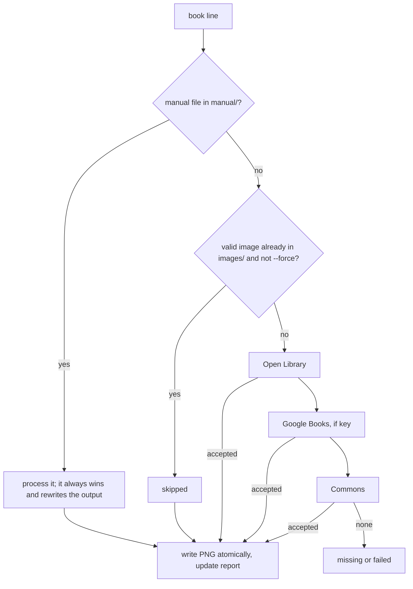

# Cover Fetch Tool

## Goal

A developer runs one command with a text list of books and gets back a folder of cover images: one PNG per book, named after the book, cut to the 2:3 proportion of a real book. The folder can be dragged straight into an external tool (the Gemini pixel-art workflow) and then thrown away. The tool looks for the most widely used cover of each book in open or API-based sources, rejects bad images (wrong shape, too small, not an image), and writes a report that says where each image came from and what is known about its rights. It is **developer tooling**: it is not part of the app, nothing at runtime depends on it, and its output is never committed or deployed.

## Scope

**In scope**

- A CLI, `npm run covers:fetch -- <list-file>`, that reads a list of at most 100 books.
- Sources, in this order: a manual drop-in folder, Open Library, Google Books (only with an API key), Wikimedia Commons.
- Normalising every accepted cover to an exact 2:3 PNG.
- A `report.json` per run with provenance, sizes and per-book outcome.
- Re-runnable behaviour: existing good output is skipped, a re-run only fetches what is missing.
- A request policy that keeps the tool inside the sources' published usage rules (identification, spacing, retries, a hard cap on list size and requests).
- Pure, injectable code so every rule above can be tested without the network.

**Out of scope**

- Anything in the app. No route, component, Prisma model, migration or seed changes, and the app never reads the tool's output. `Book.coverImage` is not touched.
- Goodreads (see *Sources and their terms*).
- Making the pixel-art versions. That happens outside this repository.
- Committing, hosting or serving the fetched images, and any decision about publishing them or their pixel versions.
- Choosing the "original" (first-edition) cover. The tool picks the most widely used cover. A specific edition is pinned by putting its ISBN on the list line.
- Other resources (author photos, bios, scene images, metadata).
- Scheduling, concurrency, a cache shared between runs, and lists over 100 books.
- A contact-sheet HTML page. The report plus the source URLs are the review aid.

## Sources and their terms

None of these sources grants rights in the cover art. Covers are normally the publisher's copyright, and the sources only provide access. The tool records what each source says, and downstream use of the images, or of anything derived from them, is outside this spec and is the user's responsibility. This is not legal advice.

| Source | Access used | What its published rules say (read 2026-10-26) | How the tool complies |
|---|---|---|---|
| **Manual drop-in** | Files the user puts in `<out>/manual/` | The user is responsible for where the file came from. | Recorded as `manual`, with `rights: "supplied by user"`. |
| **Open Library** | `search.json`, `/isbn/<isbn>.json`, covers by cover ID | The Covers API is meant for displaying covers on public pages, not bulk download, and must not be crawled. Cover access by cover ID or OLID is not rate-limited, but access by ISBN, OCLC or LCCN is limited to 100 requests per IP per 5 minutes (403 when exceeded). The general API guidelines ask for a `User-Agent` with an app name and contact, caching, no scraping of HTML, no "hundreds of single-book requests" and no use as a backend for third-party services. The default limit is 1 request/s, and 3 requests/s for identified clients. | A human-run tool with a hard cap of 100 books. Sequential requests, at least 1s apart per host. An identifying `User-Agent` that includes the contact. Only `search.json`, the edition JSON and cover-by-ID downloads are used. Cover-by-ISBN URLs are never requested. Existing output is never refetched without `--force`. The cover rights note is "publisher's copyright; Open Library grants no reuse rights". |
| **Google Books** | `volumes?q=…&key=…`, then the `imageLinks` URL | Public requests must carry an API key or an OAuth token. The Books-specific terms page (last modified 2012) only adds: no fees for users, and remove content on a rights-holder's request. The general Google APIs Terms of Service apply as well and were **not** reviewed for this spec. | Used only when `GOOGLE_BOOKS_API_KEY` is set. The key is never logged or written to the report. The rights note is "Google Books thumbnail; rights remain with the publisher". |
| **Wikimedia Commons** | MediaWiki API (`generator=search`, `imageinfo` with `extmetadata`) | Requests need a descriptive `User-Agent` with contact details, or they may be blocked. Each file has its own licence. | An identifying `User-Agent`. A file is accepted only if its licence is public domain, CC0 or CC BY(-SA), and the licence name and attribution go into `rights`. |
| **Goodreads** | not used | To my knowledge it stopped issuing new API keys in December 2020, and its terms forbid scraping. Not re-checked in this session. | Excluded. A cover found there can be saved by hand into `<out>/manual/`. |

## Data Model

There is **no database change**: no Prisma model, no migration, no seed change. The tool has three file formats and one refactor.

### Input list

A UTF-8 text file (a leading BOM and CRLF line endings are accepted), one book per line:

```text
# Title | Author | optional ISBN
The Hobbit | J.R.R. Tolkien
Dune | Frank Herbert | 978-0-441-17271-9
```

- Blank lines and lines whose first non-blank character is `#` are ignored. Surrounding whitespace is trimmed from every field.
- A line has 2 or 3 `|`-separated fields. The `|` character cannot appear in a title or author.
- `title` and `author` are required, 1–200 characters each. `author` may list several people (`Neil Gaiman & Terry Pratchett`).
- `isbn` is optional. Hyphens and spaces are removed, `x` becomes `X`, and the result must be a valid ISBN-10 or ISBN-13 (length, characters and check digit). The ISBN pins one edition, and it is the only way to pick an edition.
- At least 1 and at most **100** entries. More than that is an input error. There is no override flag.
- The list is parsed with Zod. Every problem in the file is reported at once, with its line number.

```ts
// Illustrative — scripts/covers/list.ts
type BookEntry = { line: number; title: string; author: string; isbn: string | null; slug: string };
declare function parseBookList(text: string): { ok: true; books: BookEntry[] } | { ok: false; errors: { line: number | null; message: string }[] };
```

### Output layout

```text
<out>/                      default ".covers", gitignored
  images/<slug>.png         the files to hand to the other tool, and nothing else
  manual/<slug>.(jpg|jpeg|png|webp)   optional, put there by the user
  report.json               provenance and outcome
```

- **Name:** `<slug>.png`. The slug is made from the title with the same function the seed uses, so `The Hobbit` becomes `the-hobbit`. The name always matches `^[a-z0-9]+(?:-[a-z0-9]+)*$` and is at most 100 characters. This is the same slug rule as `/books/[slug]` and the `CoverPath` rule in [book-detail-page.md](book-detail-page.md), so the files could be used by a later import spec without renaming.
- **Format:** PNG, 8-bit sRGB, no alpha channel, no metadata. The sources are almost all JPEG, so PNG adds no quality. It avoids a second lossy pass and is accepted by the usual image tools.
- **Shape:** exactly 2:3. The width is even and the height is exactly `width × 3 / 2`, so the cover box in [book-detail-page.md](book-detail-page.md) fits it with no distortion.
- **Size:** at least 400×600 and at most 800×1200. Images are never enlarged.
- **Where it ends:** `.covers/` is added to `.gitignore`. The tool refuses an `--out` inside `src/`, `public/`, `docs/`, `prisma/`, `tests/`, `scripts/` or `mockups/`, so images cannot end up in the app or in a commit by accident.

### Image rules (applied to every candidate, from every source)

Let `w × h` be the decoded size.

1. **Decode.** The bytes must decode as JPEG, PNG or WebP. Anything else (GIF, SVG, TIFF, HTML, truncated data, zero bytes) is `rejected-format`. The `Content-Type` header is not trusted. The bytes are decoded and checked.
2. **Ratio.** The source is accepted if `|3w − 2h| ≤ 0.08 × 2h` (within ±8% of 2:3). Anything further off, such as a square thumbnail or a wide box-set picture, is `rejected-ratio`.
3. **Trim.** An accepted source is cut to the largest centred 2:3 rectangle with an even width that fits inside it. Only the excess is trimmed, which is at most 8% of one dimension and at most about 4% from each edge.
4. **Minimum.** If the trimmed width is under 400 px the candidate is `rejected-size`.
5. **Scale.** If the trimmed height is over 1200 px the image is scaled down to exactly 800×1200. Otherwise the size is unchanged.
6. **Encode.** Transparency is flattened onto white, other colour spaces are converted to sRGB, metadata is dropped, and the result is written as PNG. The same input bytes always give the same output bytes.

### `report.json`

Written after **every book** (atomically), so an interrupted run leaves an accurate report. It is rewritten in full on each run, in list order.

```ts
// Illustrative — scripts/covers/report.ts, validated with Zod
type Outcome =
  | "no-match" | "no-image" | "rejected-format" | "rejected-ratio" | "rejected-size"
  | "download-failed" | "bad-response" | "not-configured" | "disabled" | "request-budget";

type ReportEntry = {
  slug: string; title: string; author: string; isbn: string | null;
  status: "ok" | "skipped" | "missing" | "failed";
  file: string | null;              // "images/<slug>.png" iff a valid image is on disk after the run
  source: "manual" | "openlibrary" | "googlebooks" | "commons" | null;
  sourceUrl: string | null;         // https, allowlisted host, never contains an API key
  rights: string | null;            // fixed note per source, plus licence name and attribution for Commons
  original: { width: number; height: number } | null;
  final: { width: number; height: number } | null;
  attempts: { source: string; outcome: Outcome; detail?: string }[];   // in the order tried
  error: string | null;
};
type Report = { generatedAt: string; list: string; disabledSources: string[]; entries: ReportEntry[] };
```

- `skipped` carries over `source`, `sourceUrl`, `rights`, `original` and `final` from the previous report when there is one, and `null` otherwise.
- **`missing`:** every source that was consulted answered, and none had an acceptable cover.
- **`failed`:** at least one source errored, was disabled or ran out of request budget, and none produced a cover.

### Refactor needed: the slug function

`slugify` in [prisma/seed.ts](../../prisma/seed.ts) is private to the seed, and importing the seed would run it. It moves, unchanged, to `src/lib/slug.ts` (a pure function, no `server-only`). The seed and the tool both import it. This is a behaviour-neutral refactor, and the seeded slugs must not change. The dependency direction is tool → `src/lib`, never `src/app` or `src/components` → tool.

## API Contracts

No Server Actions and no route handlers. The contract is the command line, the environment, the exit codes and the files above.

### Invocation

```text
npm run covers:fetch -- <list-file> [--out <dir>] [--force] [--check]
```

- `package.json` script: `"covers:fetch": "tsx scripts/covers/cli.ts"`. `tsx` is already a dev dependency.
- `<list-file>` is required. `--out` defaults to `.covers`. Unknown flags are an input error.
- `--force`: ignore existing images and fetch again. A failed re-fetch **keeps** the previous image.
- `--check`: parse and validate the list, print one `<slug>.png` line per book, make **no network request**, write nothing, and exit 0 (or 2 on errors). The contact variable is not needed.
- Runs are sequential, one request in flight at a time.

### Environment and secrets

| Variable | Needed | Use |
|---|---|---|
| `COVERS_CONTACT` | always, except with `--check` | An email address or URL put in the `User-Agent` (`TreeOfBooksCoverTool/1.0 (<contact>)`). Open Library gives identified clients 3× the rate limit and wants a contact, and Wikimedia can block clients without one. The value must be 3–200 characters with no control characters. |
| `GOOGLE_BOOKS_API_KEY` | no | Enables the Google Books source. Without it, that source is skipped and every book records `not-configured` for it. |

- Read from the process environment. If a `.env` exists in the working directory it is loaded with Node's built-in `process.loadEnvFile`, and variables already set in the environment win. No new dependency.
- `.env` is already gitignored. `.env.example` gets both names, with empty values and a one-line comment. It holds no secrets and is committed.
- The API key and the contact are never written to stdout, stderr or `report.json`. Request URLs in messages and in `sourceUrl` have `key=…` removed. These variables are not read in `src/`.

### Per-book flow



1. **Manual.** A file `<out>/manual/<slug>.(jpg|jpeg|png|webp)` is processed with the same image rules, with no network. It overrides everything, including an existing output, regardless of `--force`. If the manual file fails the image rules the book is `failed` with the reason. The tool does not quietly use a different cover.
2. **Skip.** `images/<slug>.png` counts as present only if it decodes as a PNG with an exact 2:3 shape. A corrupt, empty or wrongly shaped file is treated as absent.
3. **Sources, in order.** The first accepted candidate wins and later sources are not contacted. At most 2 candidates are tried per source. A candidate that fails the image rules, or whose download fails, moves on to the next one.

### Candidate selection per source

**Title and author matching** (shared). Both sides are lowercased, diacritics removed, punctuation dropped and whitespace collapsed.

- **Title:** a candidate matches if its full title equals the list title, or if its title cut at the first subtitle separator (`:`, `;`, `,`, `(`, ` - `, ` – `) equals it. Leading articles (`the`, `a`, `an`) are ignored on both sides. `The Hobbit, or There and Back Again` matches `The Hobbit`. `Dune Messiah` does **not** match `Dune`.
- **Author:** at least one author of the candidate shares its last name token with at least one author on the list line. The names on the list are split on `&`, ` and ` and `,`.
- A line with an ISBN skips matching, because the ISBN already names the edition.

**Open Library**

- **With an ISBN:** `GET /isbn/<isbn>.json`. The candidates are the positive IDs in `covers`, in order. A missing edition or an edition with no cover is `no-image`.
- **Without an ISBN:** `GET /search.json?title=…&author=…&limit=5&fields=key,title,author_name,cover_i,edition_count,first_publish_year`. Among the docs that match and have `cover_i`, the one with the highest `edition_count` is first (ties keep the API's order). This is the tool's proxy for "most popular": the work with the most editions, shown with the cover Open Library itself uses for the work.
- **Image:** `https://covers.openlibrary.org/b/id/<cover id>-L.jpg?default=false`, so a missing cover is a 404 and not a blank 1×1 image. The cover-by-ISBN form is never used.

**Google Books** (only with a key)

- `GET https://www.googleapis.com/books/v1/volumes` with `q=isbn:<isbn>` or `q=intitle:"<title>"+inauthor:"<author>"`, `printType=books`, `maxResults=5` and the key.
- Take the first item that matches (as above) and has `volumeInfo.imageLinks`, and use the largest link available (`extraLarge` → `large` → `medium` → `small` → `thumbnail`). The tool forces `https` and removes `edge=curl` so the cover has no page-curl effect.

**Wikimedia Commons**

- `action=query&generator=search&gsrnamespace=6&gsrsearch=<title> <author>&gsrlimit=5&prop=imageinfo&iiprop=url|size|mime|extmetadata&iiurlwidth=1200`.
- A file is a candidate only if its file name contains the normalised title **and** its `LicenseShortName` is public domain, CC0 or CC BY / CC BY-SA. Unknown, missing or "all rights reserved" licences are rejected. The thumbnail URL is preferred when Commons offers one.
- `rights` records the licence name and the attribution text.

### Request policy and failure handling

| Case | Behaviour |
|---|---|
| Identification | Every request is a `GET` with the `User-Agent` above and no cookies. |
| Spacing | At least 1000 ms between requests to the same host, and never more than one request in flight. |
| Timeout | 20 s per request, and bodies larger than 10 MB are aborted and rejected. |
| Retryable | Network errors, timeouts and HTTP 429, 500, 502, 503 and 504: up to 3 retries. The wait is the `Retry-After` value (in seconds) if it is present and at most 60, otherwise 2 s, 4 s and 8 s. A `Retry-After` over 60 s counts as exhausted. |
| Not retried | 404 and every other 4xx. The result is `no-image` or `no-match`. |
| Rate-limit lockout | A 403 from an Open Library host, or a 429 / 503 that survives its retries, **disables that source for the rest of the run**. Open Library's own limit window is 5 minutes, so hammering it would not help. The source name goes in `disabledSources`, later books record `disabled` for it, and the run continues with the other sources. |
| Request budget | At most 8 requests per book, retries included. The ninth is not sent, and the book is `failed` with `request-budget`. |
| Bad API response | JSON that does not match the expected Zod shape is `bad-response`, treated as a source error for that book. It never crashes the run. |
| Untrusted URLs | Image and redirect URLs come from API responses. They must be `https`, on the default port, with a host equal to or a dot-suffix of `openlibrary.org`, `archive.org`, `books.google.com`, `googleapis.com` or `wikimedia.org`. At most 3 redirects, and every hop is checked. `archive.org.evil.com`, `evilarchive.org`, IP-address hosts and `http:` are all rejected. |
| One book fails | It is recorded, and the run goes on with the next book. |
| Partial run | Each image is written to a temporary file and renamed. A report entry is written per book. A re-run only fetches what is missing. |
| Interrupt (Ctrl+C) | The current book is abandoned, the report is already up to date, and the exit code is non-zero. |

### Exit codes and console output

| Code | Meaning |
|---|---|
| 0 | Every book is `ok` or `skipped`. |
| 1 | At least one book is `missing` or `failed`. The images that were made are still valid. |
| 2 | Bad flags, a missing `COVERS_CONTACT`, an unreadable or invalid list, more than 100 entries, a duplicate or empty slug, a forbidden `--out`, or an unwritable output folder. Always before any network request. |

One line per book on stdout (`[12/100] the-hobbit  ok  openlibrary  800x1200`), then a summary (`ok 90, skipped 5, missing 3, failed 2`). Problems go to stderr.

### Code layout

```text
scripts/covers/
  cli.ts            argument parsing, env, exit codes
  list.ts           parseBookList, ISBN checks
  match.ts          title/author normalisation and matching
  image.ts          the image rules, PNG encoding (sharp)
  http.ts           client: spacing, retries, timeout, allowlist, redaction (fetch and clock injected)
  sources/{manual,openlibrary,googlebooks,commons}.ts
  run.ts            the per-book flow, skip/force, atomic writes, report
  report.ts         Zod schema and writer
  *.test.ts         unit tests beside each file
src/lib/slug.ts     slugify, moved out of prisma/seed.ts
```

- TypeScript, strict, no `any`, run through `tsx`. Sources take an injected `HttpClient`, and `http.ts` takes an injected `fetch`, clock and `sleep`, so tests never wait and never touch the network.
- **No new dependencies.** `sharp`, `zod` and `tsx` are already present, and Node's built-in `fetch` is used. If an implementer finds one is needed, it goes in `devDependencies` and the spec is updated.
- `vitest.config.ts` gets a third project, `tools`, that includes `scripts/**/*.test.ts` with no database setup, and a setup file that makes `globalThis.fetch` throw. Tests generate their own images in memory with `sharp`, so there are no binary fixtures.

## UI Surface

None. No route, layout, component or style changes, and no runtime link between the app and the tool. The console output and `report.json` are the only interface. `src/app/**` and `src/components/**` must not import from `scripts/`.

## Acceptance Criteria

All of these run as Vitest tests in the `tools` project, with no network and no real waiting, unless a criterion says otherwise.

**Input list**

1. `parseBookList` reads `Title | Author` and `Title | Author | ISBN` lines. It trims fields, ignores blank lines and `#` lines, accepts a BOM and CRLF, and returns entries in file order with their 1-based line numbers.
2. These produce errors that name the line: a line with 1 or 4 or more fields, an empty title or author, a field over 200 characters, an ISBN with the wrong length or characters, and an ISBN with a bad check digit. A valid ISBN with hyphens or spaces is accepted and stored as bare digits (`X` in upper case).
3. All errors in a file are returned together. With any error the CLI exits 2 and makes no network request, and `--out` is not created.
4. A list with 0 entries exits 2. A list with 101 entries exits 2 and names the count. A list with exactly 100 is accepted.
5. `slugify` returns the expected slug for at least: `The Hobbit` → `the-hobbit`, `1984` → `1984`, `Les Misérables` → `les-miserables`, `Good Omens: The Nice and Accurate Prophecies` → `good-omens-the-nice-and-accurate-prophecies`. The seed imports the same function, and its integration tests still pass unchanged.
6. Two lines that give the same slug, an empty slug (`!!!`) or a slug over 100 characters exit 2 and name the lines.

**Image rules**

7. For every accepted source, the output is a decodable PNG with an even width and a height equal to exactly `width × 3 / 2`.
8. The ±8% rule: 400×600, 1000×1500 and 1000×1400 are accepted, and 1000×1380, 600×1000, 1000×1000, 1500×1000 and 1000×2000 are `rejected-ratio`.
9. The trim is centred (the two sides differ by at most 1 px), removes only the excess, and takes at most 8% from one dimension. A marker pixel pattern in the source shows that the right region is kept.
10. A source whose trimmed width is under 400 px is `rejected-size`. 400×600 passes and 398×600 does not.
11. Output sizes: 1600×2400 and 1000×1500 both give 800×1200, 600×900 stays 600×900 (never enlarged), and 1001×1500 gives 800×1200.
12. The output PNG has no alpha channel and no metadata. A source with transparency is flattened onto white, and a CMYK JPEG comes out as sRGB.
13. JPEG, PNG and WebP sources are accepted. GIF, SVG, TIFF, an HTML page served as `image/jpeg`, truncated bytes and a zero-byte body are `rejected-format`.
14. The same input bytes give byte-identical output.
15. A body larger than 10 MB (announced by `Content-Length`, or reached while streaming) is aborted and recorded as `download-failed`.

**Sources and selection**

16. Matching: `The Hobbit, or There and Back Again` matches `The Hobbit`, `Dune Messiah` does not match `Dune`, `Brontë` matches `Bronte`, and a list line with `Neil Gaiman & Terry Pratchett` matches a candidate that lists either author.
17. Open Library without an ISBN, from a recorded `search.json`: the matching doc with the highest `edition_count` is chosen, docs without `cover_i` are skipped, and the image URL is exactly `https://covers.openlibrary.org/b/id/<id>-L.jpg?default=false`.
18. Open Library with an ISBN calls `/isbn/<isbn>.json` and uses the first positive ID in `covers`. No request to a `covers.openlibrary.org/b/isbn/…` URL is made in any test.
19. A 404 on a cover is `no-image`. The next candidate or source is then tried.
20. Without `GOOGLE_BOOKS_API_KEY`, Google Books makes no request and records `not-configured`. With a key, the query uses `isbn:` when an ISBN is present and `intitle`/`inauthor` otherwise, with `printType=books` and `maxResults=5`. It uses the largest `imageLinks` entry, forces `https` and removes `edge=curl`.
21. Commons accepts a file only when its name contains the normalised title and its `LicenseShortName` is public domain, CC0 or CC BY(-SA). Unknown, missing and "all rights reserved" licences are rejected. The licence and attribution appear in `rights`.
22. The source order is manual, then Open Library, then Google Books, then Commons. After the first accepted candidate, zero requests go to later sources. At most 2 candidates are tried per source, and each rejected candidate appears in `attempts` in order.
23. A manual file always wins over the network and over an existing output, rewrites the output regardless of `--force`, and makes no request. A manual file that fails the image rules makes the book `failed` and falls back to nothing.

**Requests, retries and limits**

24. Every request is a `GET` with a `User-Agent` of `TreeOfBooksCoverTool/1.0 (<contact>)` and no cookies. A `COVERS_CONTACT` that is missing, shorter than 3 characters, over 200 characters or contains a control character exits 2 (not required with `--check`).
25. With a fake clock, requests to the same host are at least 1000 ms apart and no two requests overlap.
26. Retries: 429, 500, 502, 503, 504, network errors and timeouts are retried up to 3 times, waiting `Retry-After` seconds if it is at most 60, otherwise 2, 4 and 8 s. A `Retry-After` of 61 or more is treated as exhausted. 404 and other 4xx are not retried. A request still running after 20 s is aborted.
27. A 403 from an Open Library host, or a 429/503 that survives its retries, disables that source: no further requests go to its hosts, the name is in `disabledSources`, later books record `disabled` for it, and the run continues with the other sources.
28. The ninth request for one book is not sent. The book is `failed` with `request-budget`, and the next book gets a fresh budget.
29. URL allowlist: `https://covers.openlibrary.org/…`, `https://ia800000.us.archive.org/…`, `https://books.google.com/…` and `https://upload.wikimedia.org/…` pass. `http://…`, `https://archive.org.evil.com`, `https://evilarchive.org`, `https://127.0.0.1/…`, `https://openlibrary.org:8443/…` and a redirect to an unlisted host are rejected without being fetched. More than 3 redirects are rejected.
30. JSON from an API that does not match the expected shape is recorded as `bad-response` for that book. The run continues and does not throw.

**Run behaviour, re-runs and files**

31. Exit codes: 0 when every book is `ok` or `skipped`, 1 when any is `missing` or `failed`, 2 for every case under exit code 2 above. Nothing is requested before a 2.
32. A book with no result does not stop the run, and the books after it are still processed. `missing` is used when every consulted source answered without an acceptable cover, and `failed` when any source errored, was disabled or hit the budget.
33. Idempotent: a second run with the same list and no `--force` makes zero requests, leaves every file's contents and modification time unchanged, exits 0, and reports every book as `skipped`.
34. An existing file that is zero bytes, not a PNG, corrupt, or not exactly 2:3 is treated as absent and is fetched again.
35. `--force` fetches every book again and replaces the files. If a forced re-fetch fails, the previous image stays and is still valid.
36. Atomic writes: if writing fails between the temporary file and the rename, no partial `<slug>.png` exists. After any run, `images/` contains only `<slug>.png` files, with no temporary files left, even after failed books.
37. After book *k*, `report.json` already contains entries for books 1 to *k* and is valid JSON. Killing the run between books loses nothing.
38. `--out` inside `src`, `public`, `docs`, `prisma`, `tests`, `scripts` or `mockups` (including `..` tricks and a symlinked path) exits 2. The default `.covers` and a path outside the repository are accepted. `.gitignore` ignores `.covers/`.
39. `--check` prints one `<slug>.png` line per book, makes no request, writes nothing and exits 0 for a valid list, and exits 2 for an invalid one.

**Report and secrets**

40. `report.json` passes its Zod schema and has one entry per list line, in list order. Every `ok` entry has a `file` that exists, a `final` that equals the real PNG size, an allowlisted `https` `sourceUrl`, and a non-empty `rights`. Entries with any other status have `file: null` unless a valid earlier image is still on disk.
41. With a fake API key and contact, including when requests fail and error text is produced, neither stdout, nor stderr, nor `report.json` contains the key. `key=` is removed from every URL that is printed or stored.
42. The summary line's counts equal the counts of statuses in `report.json`.

**Isolation and dependencies**

43. A scan of every file under `src/` finds no import of, and no reference to, `scripts/` or `covers:fetch`.
44. Imports in `scripts/covers/**` (non-test) resolve only to `node:` modules, `sharp`, `zod`, relative files and `src/lib/slug`. Any package they use is listed in `package.json` (new ones only under `devDependencies`).
45. The `tools` test project runs with `globalThis.fetch` replaced by a function that throws, and all of the above still pass. `npm run typecheck` and `npm run lint` pass with the new files.
46. Not covered by Vitest, checked once by the author: a real run on the first 5 lines of a list gives 5 viewable 2:3 PNGs of the expected books, and the `source` and `sourceUrl` in the report lead to the picture used.

## Risks and Trade-offs

- **"Most popular" is a proxy.** Open Library has no "most used cover" number. The tool takes the matching work with the most editions and the cover Open Library shows for it. That is usually the modern paperback, which is what you asked for. It can differ from what you see in a bookshop, and for a book with a famous redesign it may pick the older one. The fix is an ISBN on the line. The report's `sourceUrl` lets you check every pick.
- **"Original" cover is not built.** For old classics, first-edition covers mostly don't exist online, and finding the earliest edition costs several requests per book. The ISBN override covers the cases that matter.
- **Wrong book or wrong image.** Title and author matching reduces this but cannot remove it. Commons especially is a text search that might return the right title with the wrong picture (a poster, a map). Its filters (file name must contain the title, an open licence, the 2:3 rule) help, but the review step is to open the `images/` folder and look. Google sometimes returns a generic "image not available" tile. It is not detected, and only the size and ratio rules apply.
- **Trimming can clip edge text.** Up to about 4% per side. This is accepted because the covers are pixelated afterwards, and anything further from 2:3 is rejected rather than cropped hard.
- **This use is at the edge of what Open Library's Covers API is for.** It says it is for displaying covers and not for bulk download. A human-run, 100-book-capped, one-request-at-a-time tool that downloads one image per book is far from a crawl, but it is not "display". The cap, the spacing, the identification and the skip-existing rule are there for that reason. It should not be put in a scheduled job, and the cap should not be raised without reading their guidelines again.
- **API drift.** Open Library says its search schema is not guaranteed stable, and Google's image URL parameters are not formally documented. Zod shapes with `bad-response` mean a change breaks one source visibly and not the whole run.
- **Fixed 2:3 loses information.** A cover that really is 0.60 or 0.75 is rejected, not adapted. That favours uniform output over coverage. Books that fail on ratio can be handled by hand with the manual folder.
- **Manual-first deviates from the order we talked about.** The interview listed "manual drop-in" last. Here it is checked first, because a file you placed there is an explicit choice and costs no requests. The behaviour with nothing in `manual/` is the same.
- **Sequential and slow by design.** One request at a time with a 1 s gap means a 100-book run takes minutes. This is deliberate. The per-book budget bounds the worst case at about 800 requests.
- **We deliberately did not** add Goodreads, scraping, a headless browser, a shared cache, parallel downloads, a per-run request override, or any link to the app. Each makes the tool bigger or riskier with no gain for the stated use.

## Breaking Changes

- **Database, routes, external contracts:** none.
- **Internal, behaviour-neutral:** `slugify` moves from `prisma/seed.ts` to `src/lib/slug.ts`. The seeded slugs must be identical.
- **Repository config:** `.gitignore` gains `/.covers/`. `.env.example` gains `COVERS_CONTACT` and `GOOGLE_BOOKS_API_KEY` (empty). `package.json` gains the `covers:fetch` script. `vitest.config.ts` gains the `tools` project.
- **Dependencies:** none added.
- **Supersession:** [book-detail-page.md](book-detail-page.md) listed "fetching covers from remote sources" as out of scope. That stays true for the app. This tool is outside the app and does not change that spec.

## Open Questions

None are blocking.

1. **"Most popular" proxy.** Is "the matching Open Library work with the most editions, with Open Library's own cover for it" good enough? The alternative is a pass where you review the report and add ISBNs only where it picked wrong, which is how the tool is built to be used.
2. **Manual drop-in first.** OK that a file in `manual/` always wins, even over an existing output and without `--force`?
3. **`COVERS_CONTACT`.** The tool needs an email address or URL of yours in `.env` to identify itself to Open Library and Wikimedia. That is a value from you, not a decision.
4. **Google Books.** It needs your own API key, and the general Google APIs terms were not reviewed here. Is it worth enabling, or should it be left out of the first version? (It would only be a fallback after Open Library.)
5. **Commons.** It is the least precise source. Keep it for old public-domain classics, or leave it out of the first version?
6. **Slug refactor.** OK to move `slugify` into `src/lib/slug.ts`, so the seed and the tool share one function? The alternative is a copy in the tool, which could drift from the seed.
